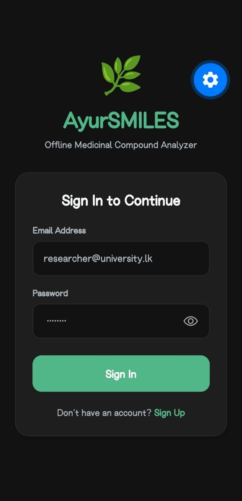
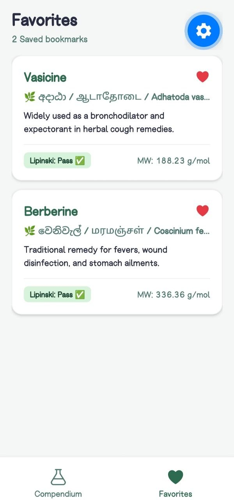
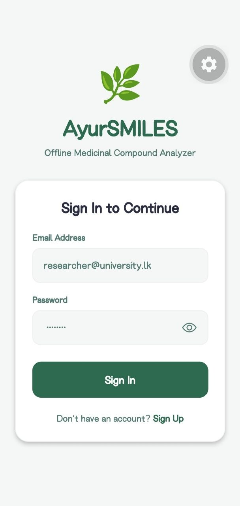
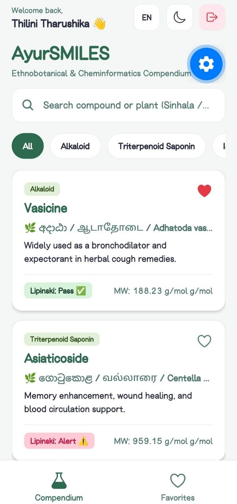
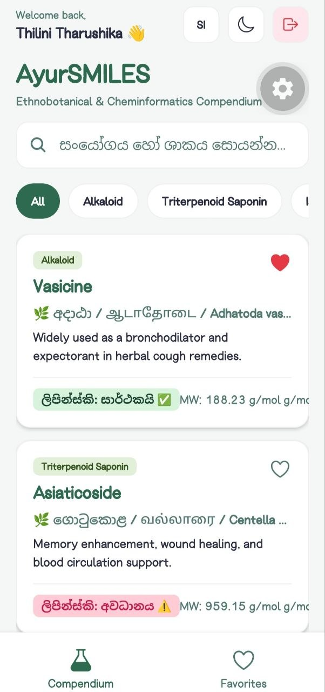
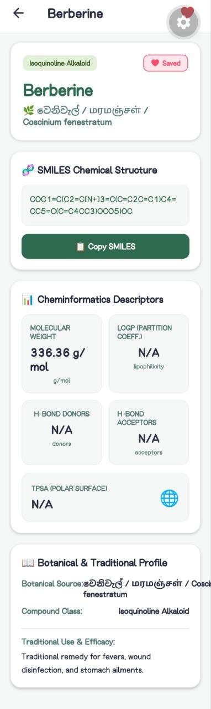

# AyurSMILES 🌿

Offline-first, trilingual (English, Sinhala, Tamil) React Native cheminformatics app bridging Ayurvedic phytochemistry with computational drug discovery.

---

## 🎯 Why AyurSMILES? (Problems Solved)

🔍 AyurSMILES solves four core ethnobotanical research bottlenecks:

* ⭐ **Plant-to-Molecule Link:** Connects traditional Ayurvedic plants directly to SMILES structures and drug-likeness profiles.
* ⭐ **Zero Internet Needed:** 100% offline-first access for field research and unstable lab connections.
* ⭐ **Trilingual UI:** Inclusive English, Sinhala, and Tamil support for students and local practitioners.
* ⭐ **Instant Screening:** Automated Lipinski’s Rule of Five checks and one-tap SMILES clipboard copying.

---

## ✨ Key Features

* **🔐 Offline Researcher Authentication:** 100% offline Sign Up, Sign In, persistent user sessions, and Sign Out powered by `AuthContext` and `AsyncStorage`.
* **🔬 Cheminformatics & Molecular Data:** View detailed physicochemical parameters including molecular weight, hydrogen bond donors/acceptors, and Lipinski's Rule of Five screening.
* **🌐 100% Offline Capability:** Fully functional local JSON database (`compounds.json`) requiring no active internet connection or remote server backend.
* **🔍 Advanced Search & Dynamic Filtering:** Real-time search across English, Sinhala, and Tamil plant sources with horizontal category pills.
* **🌙 Light & Dark Mode:** Persistent theme preferences managed via custom `ThemeContext` and `AsyncStorage`.
* **⭐ Favorites Management:** Bookmark critical compounds for quick reference and study.
* **🛡️ Clean Architecture & Navigation:** Built with Expo, React Navigation (Bottom Tabs & Native Stack), and safe area layout structures.

---

## 📱 App Screenshots

<table>
  <tr>
    <td align="center"><strong>🔐 Offline Auth</strong></td>
    <td align="center"><strong>🌿 Compendium (Home)</strong></td>
    <td align="center"><strong>🌐 Trilingual UI</strong></td>
  </tr>
  <tr>
    <td></td>
    <td></td>
    <td></td>
  </tr>
  <tr>
    <td align="center"><strong>🌙 Dark Mode</strong></td>
    <td align="center"><strong>🔬 Compound Details</strong></td>
    <td align="center"><strong>⭐ Saved Favorites</strong></td>
  </tr>
  <tr>
    <td></td>
    <td></td>
    <td></td>
  </tr>
</table>

## 🛠️ Tech Stack

* **Framework:** React Native / Expo
* **Navigation:** React Navigation (`@react-navigation/native`, `@react-navigation/bottom-tabs`, `@react-navigation/native-stack`)
* **Persistence:** `@react-native-async-storage/async-storage`
* **UI & Icons:** `@expo/vector-icons`, React Native Safe Area Context
* **Data Storage:** Local structured JSON (`compounds.json`)

---

## 📂 Project Structure

```text
AyurSMILES/
├── App.js                        # Root navigation, conditional Auth routing & Context providers
├── context/
│   ├── AuthContext.js            # Offline Sign Up, Sign In, Sign Out & session persistence
│   ├── ThemeContext.js           # Light/Dark theme state & AsyncStorage sync
│   ├── LanguageContext.js        # Trilingual translations (EN, SI, TA)
│   └── FavoritesContext.js       # Persistent bookmarking state
├── data/
│   └── compounds.json            # Offline Ayurvedic phytochemical dataset
├── screens/
│   ├── AuthScreen.js             # Researcher Sign In & Account Creation screen
│   ├── HomeScreen.js             # Compendium search, category filters, theme/language switchers
│   ├── FavoritesScreen.js        # Saved phytochemical bookmarks
│   └── DetailScreen.js           # SMILES, descriptors & Lipinski profile
└── README.md


--------------------------------------------------

🚀 Getting Started & Installation
Follow these steps to run the project locally on your machine:

Prerequisites
Node.js installed on your system

Expo Go app installed on your mobile device (or Android Studio / Xcode simulator configured)

Installation Steps
1. Clone the repository:
git clone [https://github.com/thilinitharushika/AyurSMILES.git](https://github.com/thilinitharushika/AyurSMILES.git)
cd AyurSMILES

2.Install dependencies:
npm install

(Or if using Expo specific installations):
npx expo install @react-navigation/bottom-tabs @react-navigation/native-stack @react-navigation/native @react-native-async-storage/async-storage react-native-safe-area-context @expo/vector-icons

3.Run the application:
npx expo start

4.Launch on Device:
Scan the QR code displayed in your terminal using the Expo Go app (Android) or Camera app (iOS).

##📜 License
This project is developed as part of academic coursework for institutional evaluation. All rights reserved.


